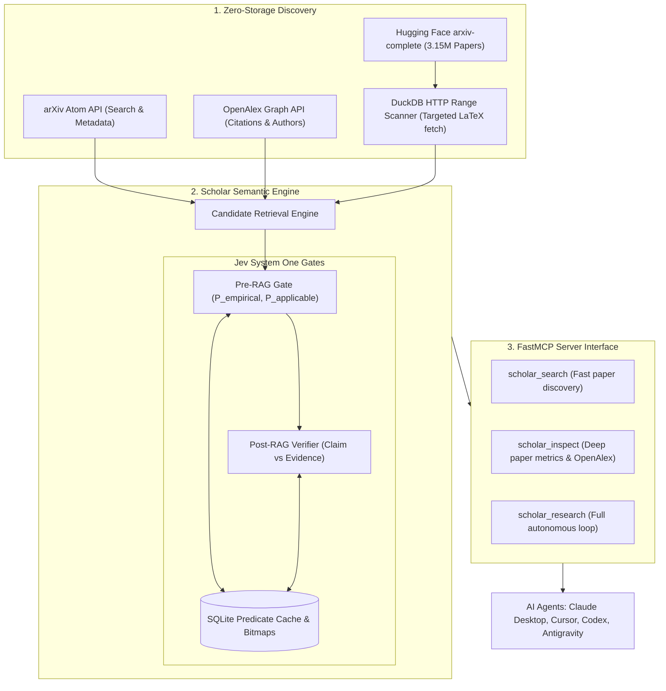

# Scholar Engine MCP 🔬⚡

> **High-speed Scientific Literature Semantic Compiler & FastMCP Server**  
> Powered by arXiv, OpenAlex, DuckDB HTTP range queries, and TypeSafe Jev System One.

[](LICENSE)
[](https://www.python.org/downloads/)
[](https://github.com/modelcontextprotocol)
[](https://typesafe.ai)

---

## 💡 Why Scholar Engine?

Traditional Retrieval-Augmented Generation (RAG) relies on **dense vector similarity** (`cos(query, chunk)`). Vector similarity is great for answering *"what text looks like my query?"*, but **fundamentally fails** on structural, empirical scientific questions, such as:

> *"Which published paper experimentally proved loaded latency reduction on real fixed wireless hardware without requiring Wi-Fi 6 PHY?"*

Vector search will return dozens of papers full of simulation equations or theoretical surveys that merely mention "wireless" and "latency" thousands of times.

**Scholar Engine** rethinks scientific discovery for AI agents by combining:
1. **Zero Storage Bloat:** Queries Hugging Face's 3.15M `arxiv-complete` Parquet dataset directly using **DuckDB HTTP range queries**. No need to download a 16 TB PDF corpus.
2. **Citation Graph Enrichment:** Instantly pulls citation metrics and author graphs via **OpenAlex**.
3. **Probabilistic Semantic Gates (Jev System One):** Natural language questions compile into persistent, 154ms probabilistic predicates (e.g. `P_real_hardware > 0.85`, `P_empirical > 0.75`).
4. **Materialized Predicate Cache:** Evaluated predicates are cached in SQLite so repeated evaluations reuse past judgments with **zero inference cost**. (The CLI and MCP server currently use an in-memory store, so the cache lasts for one process.)
5. **Double Jev Gate (Pre-RAG & Post-RAG):**
   * **Pre-RAG:** Discards non-empirical or irrelevant papers before reading full text.
   * **Post-RAG:** Verifies every claim synthesized by the reasoning agent against extracted evidence passages (`supported`, `partial`, `unsupported`, `contradicted`).

---

## 📊 Comparison Matrix

| Feature | Scholar MCP | Traditional ArXiv MCP | PaperQA2 | Elicit / Consensus |
| :--- | :---: | :---: | :---: | :---: |
| **Primary Interface** | **Local FastMCP Server** | Local MCP | Python library / CLI | Web App / Closed SaaS |
| **Search Speed** | **Sub-second to ~3s** | ~1-2s | 30s - 90s | ~5s |
| **Query Cost** | **<$0.001 (or $0 simulation)**| Free (Rate-limited API) | $1.00 - $5.00+ / run | Monthly Subscription |
| **Full-text LaTeX Access** | **Yes (DuckDB HTTP Range)** | ❌ (Abstract only) | Yes (Downloads full PDFs) | Proprietary Index |
| **Semantic Predicate Filtering** | **Yes (Jev System One)** | ❌ None | ❌ None | Heuristic filters |
| **Predicate Bitmaps Cache** | **Yes (SQLite)** | ❌ None | ❌ None | ❌ None |
| **Claim-Evidence Verification** | **Yes (Post-RAG Verifier)** | ❌ None | Yes (Heavy LLM loop) | Simple score |
| **Agent Tool Support** | **Claude, Cursor, Codex, AGY**| Partial | ❌ None | ❌ None |

---

## 🏛️ Architecture



---

## 🚀 Quick Start

### 1. Installation

```bash
# Clone the repository
git clone https://github.com/wolverin0/scholar-mcp.git
cd scholar-mcp

# Create a virtual environment and install runtime + test dependencies
python -m venv .venv
source .venv/bin/activate          # Windows: .venv\Scripts\activate
pip install -r requirements.txt "mcp<2"
```

> **Install caveats (verified 2026-11-04, Python 3.13):**
> * `pip install -e .` currently **fails**: setuptools' flat-layout auto-discovery finds two top-level packages (`scholar`, `debates`) and aborts. Until `pyproject.toml` declares its packages, install from `requirements.txt` and run the code from the repository root (or with `PYTHONPATH` pointing at it). For the same reason the `scholar` / `scholar-mcp` console scripts are not installed; use `python -m scholar.cli` and `python -m scholar.mcp.server`.
> * `mcp>=1.0.0` now resolves to **mcp 2.x**, which removed `mcp.server.fastmcp`; the server then fails at import. Pin `mcp<2` (as above) until the server is migrated.

### 2. Configuration (`.env`)

Copy `.env.example` to `.env`:

```bash
cp .env.example .env
```

```env
# Optional: TypeSafe Jev API Key for live 154ms System One probabilistic decisions
# If unset, Scholar Engine automatically runs in high-fidelity deterministic simulation mode!
TYPESAFE_API_KEY=your_typesafe_key_here
```

The code reads `TYPESAFE_API_KEY` from the process environment only; `.env` is **not** loaded automatically (no `python-dotenv`). Export it in your shell (`set -a; source .env; set +a`) or pass it in the MCP client's `env` block.

### 3. Run Tests

Verify everything is working locally (run from the repository root; 12 tests, no network or API key needed):

```bash
python -m pytest tests -v
```

### 4. Run the MCP server (stdio)

```bash
python -m scholar.mcp.server
```

---

## 🤖 MCP Server Setup

Add **Scholar Engine** to your favorite agentic tools. Because the package cannot currently be installed (see Install caveats), use the Python interpreter of the virtual environment above as `command` and set `PYTHONPATH` to the absolute path of your clone:

### Claude Desktop (`claude_desktop_config.json`)
```json
{
  "mcpServers": {
    "scholar": {
      "command": "python",
      "args": ["-m", "scholar.mcp.server"],
      "env": {
        "PYTHONPATH": "/absolute/path/to/scholar-mcp",
        "TYPESAFE_API_KEY": "your_key_here"
      }
    }
  }
}
```

### Cursor (`.cursor/mcp.json`)
```json
{
  "mcpServers": {
    "scholar": {
      "command": "python",
      "args": ["-m", "scholar.mcp.server"],
      "env": { "PYTHONPATH": "/absolute/path/to/scholar-mcp" }
    }
  }
}
```

### Antigravity / Wezbridge (`.mcp.json`)
```json
{
  "mcpServers": {
    "scholar": {
      "type": "stdio",
      "command": "python",
      "args": ["-m", "scholar.mcp.server"],
      "env": { "PYTHONPATH": "/absolute/path/to/scholar-mcp" }
    }
  }
}
```

---

## 🛠️ FastMCP Tools Reference

### 1. `scholar_search`
Quickly search arXiv for scientific papers by topic, keyword, or title, with optional publication year filtering.
* **Arguments:**
  * `query` (str): Search topic or keywords (e.g. `"loaded latency wifi"`).
  * `limit` (int, default=5): Number of candidates to return.
  * `year_min` (int, optional): Minimum publication year (e.g. `2022`).
  * `year_max` (int, optional): Maximum publication year (e.g. `2026`).
* **Returns:** Structured JSON list of IDs, titles, categories, abstracts, and PDF links.

### 2. `scholar_inspect`
Inspect a paper in detail by its arXiv ID. Merges OpenAlex citation metrics, authors, and stored semantic predicates.
* **Arguments:**
  * `paper_id` (str): arXiv paper ID (e.g. `"2007.07174"` or `"2306.04338"`).
* **Returns:** Full abstract, categories, citation counts, DOI, OpenAlex ID, and cached semantic features.

### 3. `scholar_verify_claim`
Verifies an empirical or scientific claim against a specific paper's full abstract/text. Extracts the most salient evidence passage with **exact character offsets** (`start_char`, `end_char`, `source_field`, `doc_id`).
* **Arguments:**
  * `claim` (str): Specific empirical proposition (e.g. `"Method achieves sub-5ms latency under load"`).
  * `paper_id` (str): Paper ID to verify against.
* **Returns:** Status (`supported`, `contradicted`, `unsupported`), probability score, provenance source (`live` vs `heuristic`), and exact evidence spans with character offsets.

### 4. `scholar_verify_predicate`
Directly evaluates a boolean or probabilistic proposition against any state or text passage using TypeSafe Jev System One semantics.
* **Arguments:**
  * `state_text` (str): Evidence or text passage to evaluate.
  * `question` (str): Proposition question (e.g. `"Does this passage report an in-vivo experiment?"`).
* **Returns:** Probability in `[0.0, 1.0]`, latency in ms, and provenance (`live` vs `heuristic`).

### 5. `scholar_research`
Autonomous scientific discovery loop:
1. Discovers candidates on arXiv.
2. Runs Jev System One semantic gatekeeper to filter out non-empirical or incompatible papers.
3. Resolves citation graphs and verifies claims against evidence text with exact spans.
* **Arguments:**
  * `query` (str): Research question or engineering topic.
  * `domain` (str, default=`"general"`): Domain hint (e.g. `"wireless"`, `"databases"`, `"ai"`). Currently accepted but not used by the engine.
  * `threshold` (float, default=`0.50`): Minimum probability score required to pass semantic gates.
  * `limit` (int, default=`10`): Max candidates to evaluate.
* **Returns:** Surviving evidence-backed papers with confidence metrics, exact evidence spans, and screened-out audit breakdown.

---

## 🏛️ Tri-Model AI Architectural Consensus (Claude, Codex, Gemini)

Scholar Engine's v1.1 architecture was refined and audited through a structured 3-round AI debate among the frontier LLM families:
- **Anthropic Claude (Fable 5.1 / Opus tier):** Systems safety, span-level character tracking, and CI regression harness.
- **OpenAI Codex (GPT 6 Astra / Codex tier):** 3-stage verification pipeline (`Retrieval -> Extraction -> Assessment`), bounded MCP safety, and parameter isolation.
- **Google Gemini (Gemini 3.8 Flash / Gemini 2.5 tier):** Context-aware metadata facets, audit trails for retractions, and multi-model resilience.

Read the full unedited debate logs and architectural roadmap:
- 📜 [Complete 3-Round Transcript (32 KB)](debates/001-scholar-engine-refinement/transcript.md)
- 📋 [Authoritative Architectural Synthesis & Roadmap (12 KB)](debates/001-scholar-engine-refinement/synthesis.md)

---

## 🧪 CI Evaluation Harness & Test Suite

Scholar Engine includes an evaluation harness in `tests/test_eval_harness.py` (3 tests, one of which runs a 50-case benchmark matrix through `PostRAGVerifier`):
- **Span Offset Integrity:** Verifies that extracted evidence spans match exact string slices in source documents.
- **Contradiction Detection:** Tests active refutation and negation detection.
- **Insufficient Evidence Abstention:** Validates that unrelated papers yield abstentions rather than false positives.
- **Adversarial Resilience:** Tests resistance against prompt injection in untrusted academic text (e.g., instructions attempting to override verification thresholds).
- **Provenance Demarcation:** Guarantees that every claim explicitly declares its source (`live` API vs `heuristic` fallback).

Run the full test suite:
```bash
python -m pytest tests -v
```

---

## 💻 CLI Usage

You can also use Scholar Engine directly from your terminal (from the repository root; the `scholar` console script is only available once the package installs, see Install caveats):

```bash
# Search arXiv papers
python -m scholar.cli search "neural network verification" --limit 5

# Inspect a paper with OpenAlex citation metrics
python -m scholar.cli inspect "1711.00455"

# Run the autonomous semantic research loop (--domain defaults to "wireless")
python -m scholar.cli research "wireless loaded latency scheduler" --threshold 0.50 --limit 10
```

---

## 📄 License

MIT License. See [LICENSE](LICENSE) for details.
