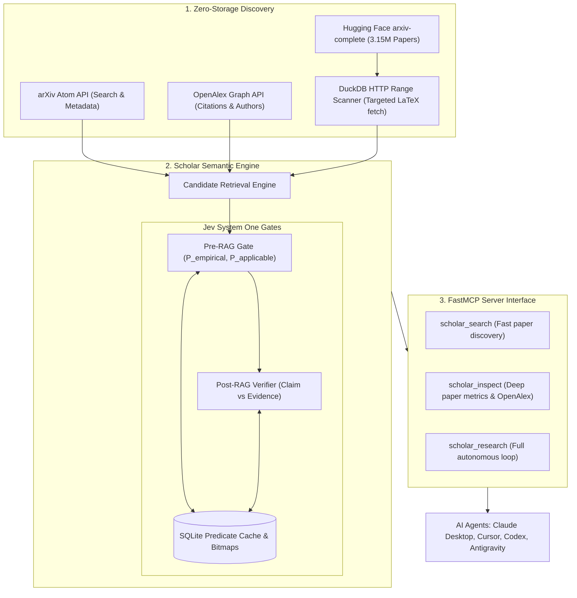

# Scholar Engine MCP 🔬⚡

> **High-speed Scientific Literature Semantic Compiler & FastMCP Server**  
> Powered by arXiv, OpenAlex, DuckDB HTTP range queries, and TypeSafe Jev System One.

[](LICENSE)
[](https://www.python.org/downloads/)
[](https://github.com/modelcontextprotocol)
[](https://typesafe.ai)

---

## 💡 Why Scholar Engine?

Traditional Retrieval-Augmented Generation (RAG) relies on **dense vector similarity** (`cos(query, chunk)`). Vector similarity is great for answering *"what text looks like my query?"*, but **fundamentally fails** on structural, empirical scientific questions, such as:

> *"Which published paper experimentally proved loaded latency reduction on real fixed wireless hardware without requiring Wi-Fi 6 PHY?"*

Vector search will return dozens of papers full of simulation equations or theoretical surveys that merely mention "wireless" and "latency" thousands of times.

**Scholar Engine** rethinks scientific discovery for AI agents by combining:
1. **Zero Storage Bloat:** Queries Hugging Face's 3.15M `arxiv-complete` Parquet dataset directly using **DuckDB HTTP range queries**. No need to download a 16 TB PDF corpus.
2. **Citation Graph Enrichment:** Instantly pulls citation metrics and author graphs via **OpenAlex**.
3. **Probabilistic Semantic Gates (Jev System One):** Natural language questions compile into persistent, 154ms probabilistic predicates (e.g. `P_real_hardware > 0.85`, `P_empirical > 0.75`).
4. **Materialized Predicate Cache:** Evaluated predicates are cached in SQLite bitmaps so subsequent runs reuse past judgments with **zero inference cost**.
5. **Double Jev Gate (Pre-RAG & Post-RAG):**
   * **Pre-RAG:** Discards non-empirical or irrelevant papers before reading full text.
   * **Post-RAG:** Verifies every claim synthesized by the reasoning agent against extracted evidence passages (`supported`, `partial`, `unsupported`, `contradicted`).

---

## 📊 Comparison Matrix

| Feature | Scholar MCP | Traditional ArXiv MCP | PaperQA2 | Elicit / Consensus |
| :--- | :---: | :---: | :---: | :---: |
| **Primary Interface** | **Local FastMCP Server** | Local MCP | Python library / CLI | Web App / Closed SaaS |
| **Search Speed** | **Sub-second to ~3s** | ~1-2s | 30s - 90s | ~5s |
| **Query Cost** | **<$0.001 (or $0 simulation)**| Free (Rate-limited API) | $1.00 - $5.00+ / run | Monthly Subscription |
| **Full-text LaTeX Access** | **Yes (DuckDB HTTP Range)** | ❌ (Abstract only) | Yes (Downloads full PDFs) | Proprietary Index |
| **Semantic Predicate Filtering** | **Yes (Jev System One)** | ❌ None | ❌ None | Heuristic filters |
| **Predicate Bitmaps Cache** | **Yes (SQLite)** | ❌ None | ❌ None | ❌ None |
| **Claim-Evidence Verification** | **Yes (Post-RAG Verifier)** | ❌ None | Yes (Heavy LLM loop) | Simple score |
| **Agent Tool Support** | **Claude, Cursor, Codex, AGY**| Partial | ❌ None | ❌ None |

---

## 🏛️ Architecture



---

## 🚀 Quick Start

### 1. Installation

```bash
# Clone the repository
git clone https://github.com/wolverin0/scholar-mcp.git
cd scholar-mcp

# Install dependencies (or install in a virtual environment)
pip install -e .
```

### 2. Configuration (`.env`)

Copy `.env.example` to `.env`:

```bash
cp .env.example .env
```

```env
# Optional: TypeSafe Jev API Key for live 154ms System One probabilistic decisions
# If unset, Scholar Engine automatically runs in high-fidelity deterministic simulation mode!
TYPESAFE_API_KEY=your_typesafe_key_here
```

### 3. Run Tests

Verify everything is working locally:

```bash
pytest -v
```

---

## 🤖 MCP Server Setup

Add **Scholar Engine** to your favorite agentic tools:

### Claude Desktop (`claude_desktop_config.json`)
```json
{
  "mcpServers": {
    "scholar": {
      "command": "python",
      "args": ["-m", "scholar.mcp.server"],
      "env": {
        "TYPESAFE_API_KEY": "your_key_here"
      }
    }
  }
}
```

### Cursor (`.cursor/mcp.json`)
```json
{
  "mcpServers": {
    "scholar": {
      "command": "python",
      "args": ["-m", "scholar.mcp.server"]
    }
  }
}
```

### Antigravity / Wezbridge (`.mcp.json`)
```json
{
  "mcpServers": {
    "scholar": {
      "type": "stdio",
      "command": "python",
      "args": ["-m", "scholar.mcp.server"]
    }
  }
}
```

---

## 🛠️ FastMCP Tools Reference

### 1. `scholar_search`
Quickly search arXiv for scientific papers by topic, keyword, or title.
* **Arguments:**
  * `query` (str): Search topic or keywords (e.g. `"loaded latency wifi"`).
  * `limit` (int, default=5): Number of candidates to return.
* **Returns:** Structured JSON list of IDs, titles, categories, abstracts, and PDF links.

### 2. `scholar_inspect`
Inspect a paper in detail by its arXiv ID. Merges OpenAlex citation metrics, authors, and stored semantic predicates.
* **Arguments:**
  * `paper_id` (str): arXiv paper ID (e.g. `"2007.07174"` or `"2306.04338"`).
* **Returns:** Full abstract, categories, citation counts, DOI, OpenAlex ID, and cached semantic features.

### 3. `scholar_research`
Autonomous scientific discovery loop:
1. Discovers candidates on arXiv.
2. Runs Jev System One semantic gatekeeper to filter out non-empirical or incompatible papers.
3. Resolves citation graphs and verifies claims against evidence text.
* **Arguments:**
  * `query` (str): Research question or engineering topic.
  * `domain` (str, default=`"general"`): Domain hint (e.g. `"wireless"`, `"databases"`, `"ai"`).
  * `threshold` (float, default=`0.50`): Minimum probability score required to pass semantic gates.
  * `limit` (int, default=`10`): Max candidates to evaluate.
* **Returns:** Surviving evidence-backed papers with confidence metrics and screened-out audit breakdown.

---

## 💻 CLI Usage

You can also use Scholar Engine directly from your terminal:

```bash
# Search arXiv papers
scholar search "neural network verification" --limit 5

# Inspect a paper with OpenAlex citation metrics
scholar inspect "1711.00455"

# Run the autonomous semantic research loop
scholar research "wireless loaded latency scheduler" --threshold 0.50 --limit 10
```

---

## 🤝 Contributing & Community Roadmap

We built Scholar Engine to bring rigorous scientific grounding to AI coding and research agents. We welcome contributions to make it even more capable!

- [ ] **Domain Predicate Packs:** Community-curated semantic predicates for specific fields (Biomedical, Systems/Networking, Cryptography, Robotics).
- [ ] **Local Small-Model Distillation:** Distill common predicate evaluations into local open-weights SLMs (e.g., local 0.5B - 3B models) for 100% offline edge execution.
- [ ] **Roaring Bitmaps on DuckDB:** Materialize precomputed semantic indices across all 3.15M arXiv papers into compact Parquet bitmap columns.
- [ ] **PubMed & bioRxiv Source Adapters:** Expand beyond arXiv into life sciences and medical literature.

---

## 📄 License

MIT License. See [LICENSE](LICENSE) for details.
